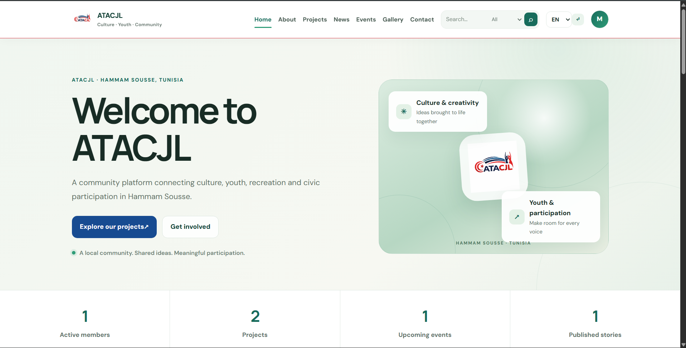
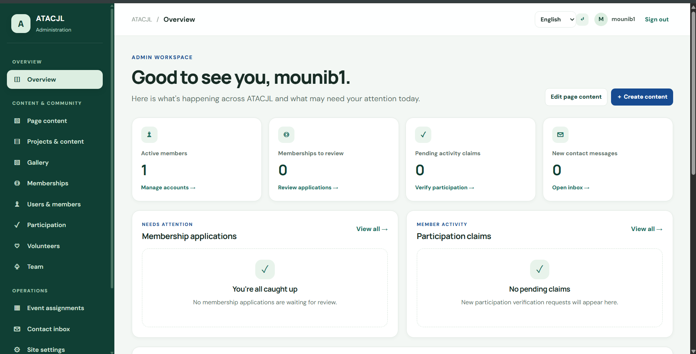
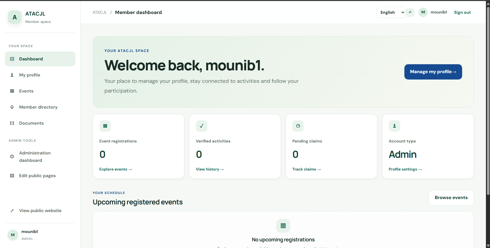

# ATACJL — Community Association Website

ATACJL is a PHP and MySQL website for a community association in Hammam Sousse, Tunisia. It brings the public website, member area, and administration tools together in one application.

## Features

- **Public website:** About, projects, news, events, gallery, contact, membership, and volunteering pages.
- **Member area:** Account registration and login, profile management, member directory, event listings, and participation claims.
- **Administration:** Manage projects, news, events, gallery albums, team members, users, membership applications, volunteer applications, contact messages, and site settings.
- **Content management:** Edit selected public-page text and maintain multilingual content fields.
- **Language support:** English, French, Arabic, German, Italian, and Spanish language selection, including right-to-left layout for Arabic.
- **Security controls:** Password hashing, CSRF protection for form submissions, role checks, prepared database queries, escaped output, and session-cookie protections.
- **Responsive layout:** Shared styling for desktop and mobile screens, with separate navigation for public pages, members, and administrators.

## Screenshots

### Homepage


### admin workspace


### member dashboard



## Technology

- PHP 8.2 or later
- MySQL 8+ or a compatible MariaDB release
- PDO MySQL
- Apache with `mod_rewrite` (or equivalent web-server rules)
- PHP extensions: `pdo_mysql`, `mbstring`, `curl`, and `fileinfo`

## Local setup

### 1. Configure the environment

Copy `.env.example` to `.env` and update the values for your machine:

```bash
cp .env.example .env
```

On Windows, create a copy of `.env.example` named `.env` using your editor or file manager.

Set at least `APP_URL`, `DB_HOST`, `DB_PORT`, `DB_NAME`, `DB_USER`, and `DB_PASS`. The included schema creates a database named `atacjl_db`; if you choose another database name, update the schema and migration scripts to match.

Never commit `.env` or put real API keys in source control.

### 2. Create the database

For a new installation, import the schema:

```bash
mysql -u root -p < database/schema.sql
```

Use a MySQL account with permission to create the database and tables. The schema includes the initial application tables and site settings.

For an existing installation, back up the database first. Review the migration scripts in `database/` and apply only the migrations needed to bring that database up to date, in order. Do not import the fresh-install schema over an existing database.

### 3. Create an administrator

From the project root, run:

```bash
php scripts/create-admin.php
```

The script is intended for terminal use. It asks for the administrator's username, name, email, and password; it does not provide a default admin password. Use a unique password of at least 12 characters.

### 4. Start the local site

For a quick local check, run the PHP development server from the project root:

```bash
php -S 127.0.0.1:8000
```

Then open [http://127.0.0.1:8000](http://127.0.0.1:8000). The PHP development server is for local development only; use a properly configured web server for production.

Sign in through `/login.php` with the administrator account you created.

## Optional services

### Image uploads

Image uploads use ImgBB when configured. Add your own `IMGBB_API_KEY` to `.env`, or configure the relevant setting in the administration area. Keep API keys private.

### Automatic translation

Automatic translation uses a LibreTranslate-compatible service. Configure the provider URL and, if required, its API key in **Admin → Site settings**. Public community endpoints can be unreliable; use a provider you trust for production. Translation availability and quality depend on that provider.

## Security and deployment checklist

Before publishing the site to a public server:

- Serve the application over HTTPS.
- Use a dedicated database user with only the permissions the application needs.
- Keep `.env`, logs, backups, and private uploads outside public access.
- Change any credentials that may have been used during development.
- Back up the database before applying migrations or deploying updates.
- Test login, registration, administrator actions, event registration, contact forms, image uploads, and language switching on the target environment.
- Add rate limiting and monitoring appropriate to the hosting environment.

The member documents page is not a private document-storage system. Do not store confidential member files in a publicly accessible directory.

## Project structure

```text
.
├── admin/              Administration pages
├── assets/             CSS, JavaScript, and image assets
├── database/           Fresh schema and incremental migrations
├── includes/           Shared configuration, database, auth, and helpers
├── member/             Member portal
├── scripts/            Command-line maintenance scripts
├── storage/            Runtime storage and logs
├── .env.example        Environment configuration template
├── index.php           Public home page
└── login.php           Sign-in page
```

## License

No license file is currently included. Contact the project maintainers before redistributing or reusing the code if licensing terms have not been agreed.
